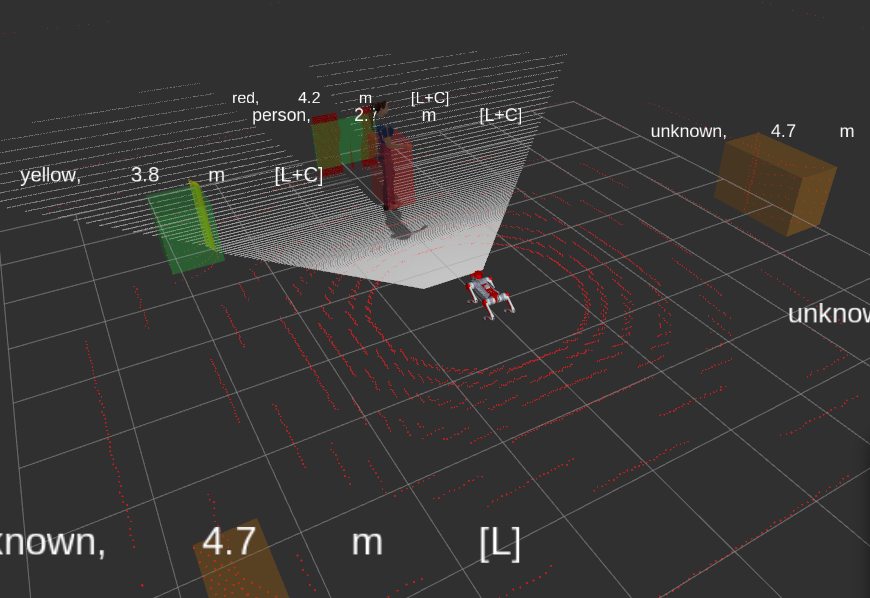
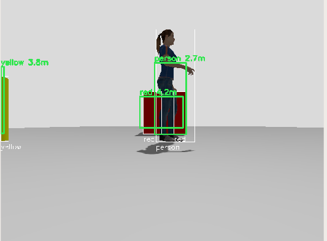
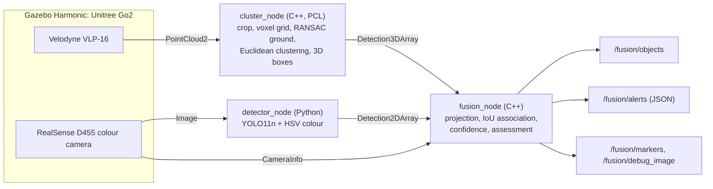

# Go2 Sees in 3D

[](https://github.com/kavinaya2808/go2-sees-in-3d/actions/workflows/ci.yml)

LiDAR–camera fusion for a Unitree Go2 quadruped in simulation. A C++/PCL pipeline segments
objects in the 3D point cloud, a camera detector classifies them, and a fusion node combines
both into labelled 3D objects with distance, confidence and sensor agreement, for example
**"person, 2.7 m [LiDAR + camera]"**.

| Fused objects in RViz | Camera view with projected LiDAR clusters |
|---|---|
|  |  |

Green: confirmed by LiDAR and camera. Orange: LiDAR only (outside the camera's field of view).

## Results

Measured against Gazebo ground truth with [`tools/evaluate.py`](tools/evaluate.py):
6 scenes, 120 fused scans, 720 object instances. Raw data in [`results/eval.csv`](results/eval.csv).

| Metric | Value |
|---|---|
| Person position error | **0.105 m mean, 0.083 m median** |
| Person correctly labelled when visible to the camera | **100 %** (80 / 80) |
| Person localised by LiDAR alone, behind the robot | 0.10 m error |
| LiDAR object detection rate (≤ 8 m) | 97.2 %, all misses from full occlusion |
| Box and cylinder centre error | 0.18–0.48 m, from box centres fitted to the visible faces only |
| LiDAR pipeline runtime | 7.6 ms mean per scan |
| Unit tests | 18 GoogleTest cases, run in CI |

## Robot and sensors

| | Model | Data | Role in the pipeline |
|---|---|---|---|
| Robot | Unitree Go2, CHAMP gait controller | `/cmd_vel` | Mobile sensor platform |
| 3D LiDAR | Velodyne VLP-16, 16 × 440 points | `sensor_msgs/PointCloud2` | Where objects are, and how far away |
| Camera | Intel RealSense D455 colour, 640 × 480, 85° HFOV | `sensor_msgs/Image`, `CameraInfo` | What the objects are |

## Architecture



## Method

**1. LiDAR segmentation** (`go2_perception`, C++17 / PCL)

1. Remove invalid points, crop to a region of interest and cut out the robot's own body.
2. Downsample with an 8 cm voxel grid.
3. Remove the ground with RANSAC, constrained to near-horizontal planes so box sides are never mistaken for floor.
4. Group the remaining points by Euclidean clustering (k-d tree, 35 cm tolerance) and fit an axis-aligned 3D box to each cluster.

**2. Camera detection** (`go2_detector`, Python)

- YOLO11n for people, plus HSV colour segmentation for the coloured test objects. Both run on every frame and their detections are combined.

**3. Fusion** (`go2_fusion`, C++17)

1. **Projection.** Transform the 8 corners of each LiDAR box into the camera's optical frame using TF, then project them with the pinhole model (intrinsics from `CameraInfo`) to get a 2D box.
2. **Association.** Match projected boxes to camera detections by IoU, greedy and one-to-one. Unmatched detections that lie inside an object already labelled with the same class are treated as occlusion fragments.
3. **Confidence.** `1 − (1 − p_lidar)(1 − p_camera)` (noisy-OR), with every object tagged `lidar`, `camera` or `lidar+camera`.
4. **Assessment.** One JSON per scan. Objects of a watched class (default `person`) inside a radius (default 5 m) are raised to `alert`.

```json
{"id": 0, "class": "person", "sensors": "lidar+camera", "confidence": 0.96,
 "distance_m": 2.71, "bearing_deg": -2.57, "position": {"x": 2.71, "y": -0.12, "z": 0.24},
 "level": "alert"}
```

## ROS interface

| Topic | Type | Description |
|---|---|---|
| `/perception/clusters` | `vision_msgs/Detection3DArray` | LiDAR clusters (LiDAR frame) |
| `/perception/detections_2d` | `vision_msgs/Detection2DArray` | Camera detections (pixels) |
| `/fusion/objects` | `vision_msgs/Detection3DArray` | Labelled 3D objects with confidence |
| `/fusion/alerts` | `std_msgs/String` | JSON assessment per scan |
| `/fusion/markers` | `visualization_msgs/MarkerArray` | RViz boxes and labels |
| `/fusion/debug_image` | `sensor_msgs/Image` | Camera image with projected LiDAR boxes |

All parameters are in [`go2_bringup/config/perception.yaml`](go2_bringup/config/perception.yaml).

## Repository structure

```
go2-sees-in-3d/
├── go2_perception/        C++ LiDAR pipeline: cloud_pipeline (PCL, ROS-free) + cluster_node
│   └── test/              GoogleTest: clustering, ground removal, self-filter, NaN handling
├── go2_detector/          Python 2D detector: YOLO + HSV colour backends
├── go2_fusion/            C++ fusion: projection (ROS-free maths) + fusion_node
│   └── test/              GoogleTest: projection, frame transforms, IoU, association
├── go2_bringup/           Launch file and YAML configuration
├── tools/
│   ├── evaluate.py        Accuracy against Gazebo ground truth
│   ├── spawn_person.sh    Adds a person to the running simulation
│   └── move_model.sh      Repositions a model to set up a new test scene
├── results/eval.csv       Evaluation data behind the results table
├── docs/                  Images used in this README
├── docker/                Dockerfile and run script (ROS 2 Jazzy, Gazebo Harmonic)
├── deps.repos             Pinned simulator dependency
└── .github/workflows/     CI: build and unit tests
```

## Reproduce

Requires Docker on Linux with an X11 desktop. An NVIDIA GPU with the NVIDIA Container Toolkit is recommended for rendering the simulated sensors.

**1. Get the code and the pinned simulator**

```bash
mkdir -p ~/go2_ws/src && cd ~/go2_ws/src
git clone https://github.com/kavinaya2808/go2-sees-in-3d.git
vcs import < go2-sees-in-3d/deps.repos    # or: git clone the URL listed in deps.repos
```

**2. Build and start the container**

```bash
cd go2-sees-in-3d
docker build -t go2_sees_3d:jazzy docker/
WS=~/go2_ws ./docker/run.sh
```

Open more terminals in the running container with `docker exec -it go2_sees_3d bash`.

**3. Build the workspace** (inside the container)

```bash
cd /root/go2_ws
rosdep install --from-paths src --ignore-src -r -y
colcon build --symlink-install
source install/setup.bash
```

**4. Run** (one terminal per step)

```bash
# Terminal 1: simulation (press Play in Gazebo if it starts paused)
ros2 launch unitree_go2_sim unitree_go2_launch.py rviz:=true

# Terminal 2: add a person, then start perception and fusion
src/go2-sees-in-3d/tools/spawn_person.sh 3.0 0.0
ros2 launch go2_bringup perception.launch.py

# Terminal 3: drive the robot (i forward, j/l turn, k stop)
ros2 run teleop_twist_keyboard teleop_twist_keyboard
```

In RViz, add `/fusion/markers` (MarkerArray) and `/fusion/debug_image` (Image).
To see the JSON assessment:

```bash
ros2 topic echo /fusion/alerts --once --full-length
```

**5. Test and evaluate**

```bash
colcon test --packages-select go2_perception go2_fusion && colcon test-result --verbose

# Record one scene, then move the person (or the robot) and repeat
cd src/go2-sees-in-3d
python3 tools/evaluate.py --label person1=person
./tools/move_model.sh person1 3.5 -1.5
```

`evaluate.py` reads the true poses of the robot and the objects from Gazebo, transforms them
into the LiDAR frame and compares them with the fused output. Each run appends to
`results/eval.csv` and prints the summary over all recorded viewpoints.

## Built with

ROS 2 Jazzy · Gazebo Harmonic · C++17 · PCL · Eigen · OpenCV · Ultralytics YOLO · GoogleTest · GitHub Actions · Docker.
Go2 simulation and CHAMP controller from [khaledgabr77/unitree_go2_ros2](https://github.com/khaledgabr77/unitree_go2_ros2).

## License

MIT
